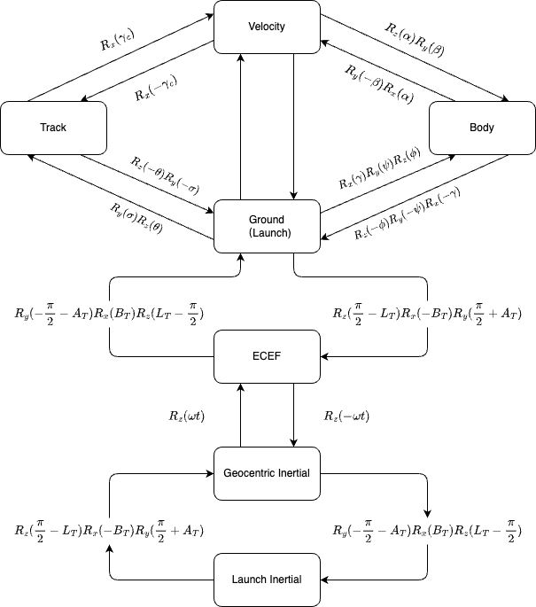

# Coordinate Transformation Toolbox - Aerospace Extension

## Software requirements

- MATLAB > R2019a

> Some machines may not be able to display UTF-8 characters due to backward configuration. Please use an advanced editor to open and view the original file.

## Design Principle

This toolbox is designed based on the MATLAB `Mapping` toolbox. By ensuring high similarity and readability with the official API, it reduces the learning cost for users and the testing cost for developers.

Its main design principles are as follows

- Function names adopt name pattern in the `Mapping` toolbox, while
  - add prefix `c` to the coordiate transformation function
  - add prefix `q` to the quaternion function
  - add prefix `u` to the unit conversion function
  - add prefix `get_` to the calculation function
- Input includes parameter type verification
- Output dimension flexibility
- Use MATLAB builtin functions wherever possible
- Reference ellipsoid model is written in object-oriented form to facilitate subsequent expansion
- Encoding only uses UTF-8

## Dependencies

This is the aerospace extension layer and is not self-contained. It relies on:

- `matlab-geodesy` (the sibling toolbox), which must be on the path. Used symbols:
  `refEllipsoid`, `cgeodetic2ecef`, `cecef2geodetic`, `cecef2enu`, `cecef2enuv`,
  `cenu2ecefv`, `cenu2aer`, `caer2ecef`, `cen2ar`.
- MATLAB Aerospace Toolbox for the Earth-centered inertial transforms
  (`cecef2eci`, `ceci2ecef`, `caer2eci`, `ceci2aer`), which call `siderealTime` and
  `juliandate`.

## Known limitations

The launch/velocity/body orientation stubs and the antenna/platform/RFC spherical
projection family were previously non-functional (they called undefined helpers
`unedv2euler` / `rlaunch2vel` and used a garbled `M` projection). They have been
reconstructed, but because the schema and the toolbox never defined the exact
original semantics, the reconstruction follows the toolbox's own conventions and
makes a few explicit assumptions. Review these before relying on the results:

- Launch / velocity orientation — `claunch2body`, `claunch2vel`, `cvel2launch`
  (with the new helpers `unedv2euler`, `rlaunch2vel`) now form exact inverses of
  the runnable `cbody2launch`. The body/velocity attitude is inferred from the
  velocity vector as heading + flight-path angle with **zero bank** (roll is not
  observable from a single velocity vector); `lift` / `side_force` and any
  angle-of-attack / sideslip generalization are accepted but **not** used. Supply
  explicit Euler angles via `cbody2launch` when the full attitude is known.
- Antenna / platform / RFC projection — `cant2rfc` / `crfc2ant` rotate the target
  into the boresight frame via `renu2rfc` and extract spherical coordinates with
  the `matlab-geodesy` `cenu2aer` convention. `cant2platform` / `cplatform2ant`
  treat the platform frame as the ENU reference frame, because no separate
  platform-frame rotation exists in the schema; the reference `az0` / `elev0` /
  `rslant0` therefore do not affect the platform result.
- `claunch2ecef` was already runnable and is confirmed correct; note the schema's
  Ground→ECEF edge mislabels the middle term as `R_z(B_T)` — the inverse edge and
  the code both use `R_x(B_T)`.

All of the above are exercised by round-trip self-checks in `test/test_regression.m`
(self-consistency only — no external ground-truth constants are asserted).

> Dotted line in the schematic diagram indicates indirect transformation, which may cause cumulative errors
